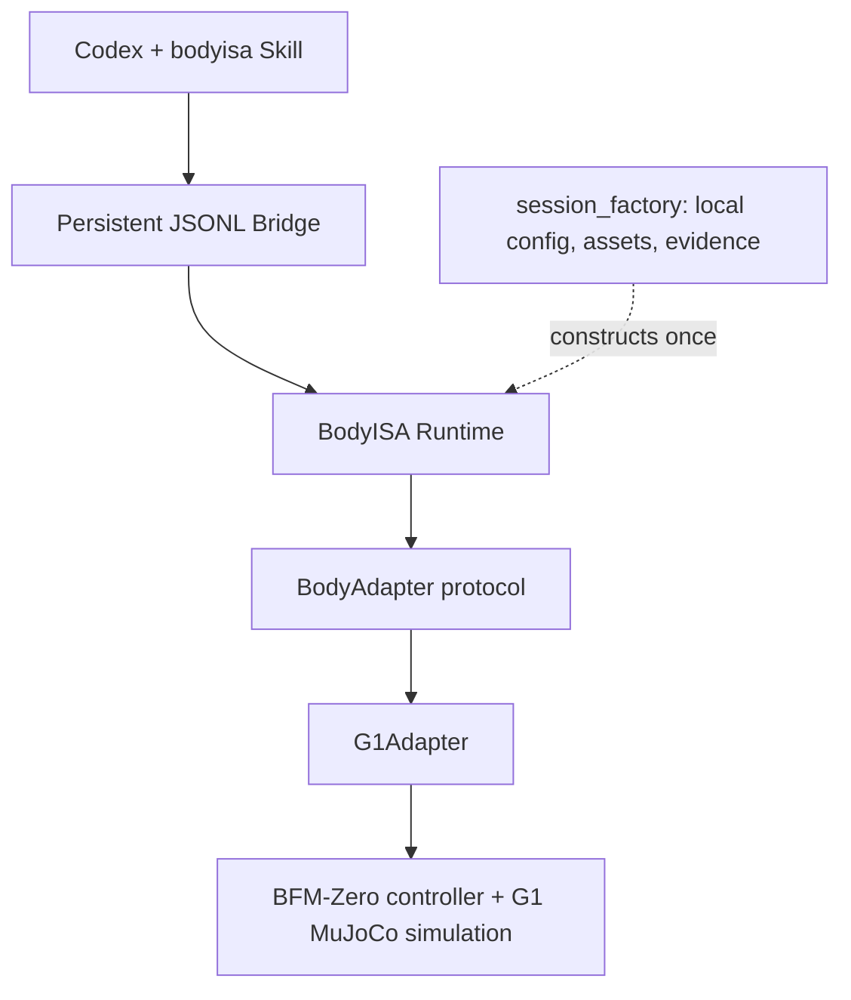

# BodyISA

BodyISA gives Codex a persistent, semantic interface to a simulated robot body.
It authorizes each instruction against local reviewed evidence, checks the actual
entry state and preceding execution, and determines the result from physical
state and execution contracts.



**Implemented:** `G1Adapter`, embodiment **G1**, controller **BFM-Zero**,
execution backend **MuJoCo**, `SIM_ONLY`, control dt 0.02 s. `BodyAdapter` is the
injection boundary for future implementations; no other robot is implemented.

The current reviewed context allows one controlled initialization → STAND →
`TRACK_MOTION(dance_prefix_500, JOINT_TRAJECTORY_V2)` → explicit STAND → CLOSED.
Each operation must be requested separately and pass current eligibility.
TRACK requires 500 semantic samples, defined invariants and terminal STAND
stabilization. Its joint-trajectory profile does not guarantee an in-place
motion, zero drift or a world path. GO_TO, TURN_TO, arbitrary poses/motions,
repeated TRACK, unknown-state recovery and hardware are unsupported.

## Install

Python 3.10+; the physically checked environment uses Python 3.10, MuJoCo 3.3.7,
PyTorch 2.5.1 with CUDA 12.1 and an NVIDIA GPU. Base types, tests and `--help`
do not load a model or initialize CUDA.

```powershell
git clone https://github.com/Harbara-Ai/BodyISA.git
cd BodyISA
python -m venv .venv
& '.\.venv\Scripts\python.exe' -m pip install -e .
& '.\.venv\Scripts\python.exe' -m bodyisa.bridge.jsonl --help
```

For physical execution, obtain the external BFM source, checkpoint, G1 assets,
motion, exact latent caches and reviewed deployment evidence described in
[ASSETS](docs/ASSETS.md). No model is downloaded automatically. Install the
matching PyTorch build and G1 dependencies in this environment:

```powershell
& '.\.venv\Scripts\python.exe' -m pip install torch==2.5.1 --index-url https://download.pytorch.org/whl/cu121
& '.\.venv\Scripts\python.exe' -m pip install -e '.[g1]'
Copy-Item configs/g1_bfm_mujoco.example.json configs/g1_bfm_mujoco.local.json
```

Edit every external path in the local JSON; paths resolve relative to that
configuration file, independent of the working directory. Select a new
`output_dir` for a new episode. The current delivery setup fixes seed 91000.
Cloning code neither supplies model weights nor grants automatic certification.
See [REPRODUCE](docs/REPRODUCE.md) for evidence verification and migration review.

## Start one persistent session

```powershell
& '.\.venv\Scripts\bodyisa-mujoco.exe' --robot g1 --config configs/g1_bfm_mujoco.local.json
# Equivalent entry:
& '.\.venv\Scripts\python.exe' -m bodyisa.bridge.jsonl --robot g1 --config configs/g1_bfm_mujoco.local.json
```

Wait for one JSON line with `status="READY"`. stdout is protocol JSONL; model
diagnostics use stderr. Keep this process alive and write requests to its stdin:

```jsonl
{"tool":"describe_capabilities"}
{"tool":"get_state"}
{"tool":"STAND"}
{"tool":"describe_capabilities"}
{"tool":"TRACK_MOTION","arguments":{"target":"dance_prefix_500","contract_profile":"JOINT_TRAJECTORY_V2"}}
{"tool":"STAND"}
{"tool":"get_execution","arguments":{"execution_id":"002_TRACK_MOTION"}}
```

Wait for each response; check `admission`, actual `outcome.status`,
`semantic_assessment`, `exit_stabilization_outcome`, `phase` and `capabilities`.
`ACCEPTED` alone is not SUCCESS. Responses include session/execution identity,
simulation time, state, current eligibility and local evidence references.
Unknown fields, controls, evidence paths, permit, reset and contract overrides
are rejected. Waiting for the next request pauses simulation; wall time does not
count toward stable hold. CLOSED retains queries but rejects repeated actions.
EOF closes resources; restarting explicitly creates a different episode.

## Codex

Open this repository as the Codex workspace. First message:

> $bodyisa 查询当前 G1 仿真的能力，不要执行动作。

After inspecting the response, request actions individually: “先站稳。” / “演示当前注册的舞蹈片段。” / “最后站稳。”
The [bodyisa Skill](.agents/skills/bodyisa/SKILL.md) describes persistent terminal
use and result interpretation. Runtime eligibility determines the available
order. This JSONL Bridge is not MCP, and the Skill is not a security sandbox.
See [CODEX_USAGE](docs/CODEX_USAGE.md) for terminal/session details.

## Python API and validation

```python
from bodyisa.session_factory import create_session
from bodyisa.core import Instruction

session = create_session("configs/g1_bfm_mujoco.local.json", robot="g1")
try:
    print(session.describe_capabilities())
    path = session.start_instruction(Instruction("STAND"))
    outcome = None
    while outcome is None:
        outcome = session.tick()
    print(outcome.status, path)
finally:
    session.adapter.close()
```

[examples/g1_sequence.py](examples/g1_sequence.py) is an explicit three-action
example; [examples/jsonl_client.py](examples/jsonl_client.py) reuses one subprocess.
Normal startup never runs a benchmark or generates approval.

```powershell
# Base/protocol tests; no external robot assets
python -m unittest discover -s tests -p test_protocol.py -v
# Preserved physical-boundary regressions; explicit external BFM source/assets
$env:BODYISA_BFM_ROOT = 'C:\external\BFM-Zero-minimal'
python -m unittest discover -s tests -v
# Asset hash precheck, no model initialization
bodyisa-mujoco --robot g1 --config configs/g1_bfm_mujoco.local.json --precheck
```

Physical smoke uses the persistent JSONL sequence above and the read-only
[smoke checker](evaluation/smoke.py); exact procedure and comparison tolerances
are in [REPRODUCE](docs/REPRODUCE.md). Results are in
[experiments](docs/experiments/RESULTS.md), with legacy process completion kept
separate from v2 semantic success.

To add another body, implement [BodyAdapter](bodyisa/adapters/base.py), add a
concrete Adapter/profile and explicit factory binding, and independently validate
its evidence and entry scope. Do not add robot branches in shared Runtime or
claim support from directory structure. See [ARCHITECTURE](ARCHITECTURE.md) and
[MIGRATION](docs/MIGRATION.md).

BodyISA's own publication license remains to be confirmed by its owner. The
original BFM license text is retained under `licenses/` for that external
dependency only; it is not applied to all BodyISA code. See
[THIRD_PARTY_NOTICES](THIRD_PARTY_NOTICES.md).
